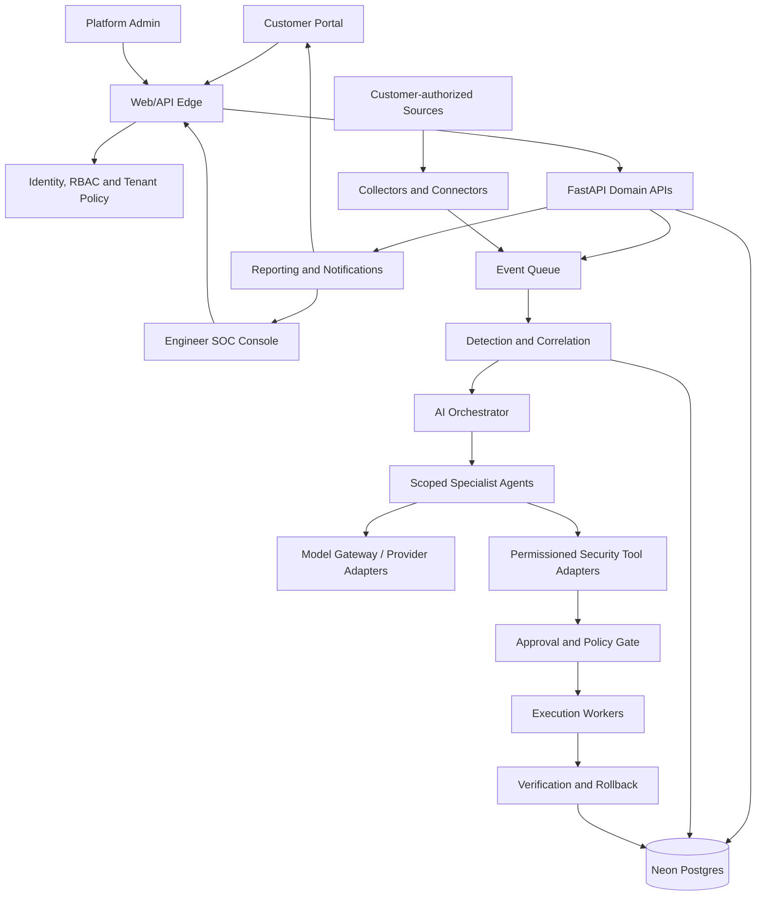

# AEGIS Architecture

**Status:** Target architecture and implementation baseline  
**Product scope:** Multi-tenant managed cybersecurity operations across industries and organization sizes.

## 1. Product architecture

AEGIS has four cooperating surfaces:

1. **Customer portal** — customer administrators onboard their organization, connect authorized assets, review posture/findings/incidents, approve remediation and access reports.
2. **Security operations console (SOC)** — AEGIS engineers triage a unified queue, investigate assigned tenants, review evidence and AI recommendations, request approvals, execute authorized playbooks and document outcomes.
3. **Platform administration** — privileged staff manage tenant lifecycle, plans, policy templates, integrations, access, service health and platform-wide audit. Platform-wide access is exceptional and audited.
4. **AI orchestration layer** — coordinates specialist agents, model providers and defensive tools under explicit tenant scope and policy.

The customer portal and SOC console share backend services but have separate navigation, authorization policies and user experiences.

## 2. Logical system diagram



All paths that access customer data or execute tools must carry a verified tenant context and actor identity. The diagram is logical; implementation may split components into deployable services as load and operational needs become clear.

## 3. Deployment and technology baseline

| Layer | Baseline | Responsibility |
|---|---|---|
| Web frontend | React, TypeScript, Tailwind; Vercel | Customer portal, SOC console, administration |
| API | Python, FastAPI; Render | Authentication integration, domain APIs, authorization, workflows |
| Background processing | Python workers on Render initially; queue-backed | Ingestion, correlation, scans, agent tasks, reports and notifications |
| Primary database | Neon Postgres | Transactional system of record, tenant metadata and audit references |
| Queue/cache | Managed Redis-compatible queue or equivalent | Back-pressure, retries, scheduled jobs and short-lived coordination |
| Event/log storage | Object storage plus searchable event platform as needed | High-volume raw telemetry, evidence and retention |
| AI gateway | Internal provider adapter interface | Routing, budgets, model selection, fallback and telemetry |
| Observability | Centralized metrics, traces, structured logs and alerting | Service health, detection pipeline health and operational audit |

Keep the first deployment modular rather than prematurely splitting every domain into microservices. Separate API, ingestion, worker and AI execution processes so they can scale independently. Do not put unbounded raw telemetry in the transactional database.

## 4. Core domain boundaries

- **Identity and access:** users, sessions, service identities, roles, permissions and MFA integration.
- **Tenant management:** organizations, memberships, subscriptions, tenant configuration, data residency and retention settings.
- **Asset inventory:** cloud accounts, hosts, endpoints, repositories, domains, identities, network sensors and ownership.
- **Integrations:** connector configuration, scopes, credential references, health, sync cursors and revocation.
- **Telemetry and detection:** normalized events, rules, detections, correlation cases and evidence pointers.
- **Vulnerability and posture:** assets, findings, severity, exposure, remediation guidance and status history.
- **Incident management:** incidents, timelines, tasks, evidence, assignments, severity and customer communication.
- **AI orchestration:** agent runs, prompts/templates, model selection, tool calls, confidence, citations/evidence and evaluation.
- **Approvals and actions:** proposed actions, risk tier, approver, decision, execution record, verification and rollback.
- **Reporting and compliance:** posture snapshots, incident reports, control mappings and export history.
- **Audit:** append-only record of sensitive reads/actions, policy decisions, approvals and administrative changes.

Use stable IDs, UTC timestamps, explicit status transitions and tenant ownership on all tenant-owned records.

## 5. Multi-tenant isolation

AEGIS serves multiple customer organizations on shared infrastructure. Isolation is a security boundary, not just a UI filter.

- Every tenant-owned row has a non-null `tenant_id`; relationships validate that referenced objects belong to the same tenant.
- API authorization derives tenant membership from the authenticated principal and server-side policy, never from a trusted client-supplied tenant ID alone.
- Enforce tenant scoping in domain/service queries and database row-level security where appropriate; use both application checks and database defense in depth.
- Background jobs, agent runs, cache keys, object-storage paths and search indexes carry tenant scope.
- Never allow cross-tenant joins, search, model context, logs or reports by default.
- Platform support access is time-bound, purpose-bound, least-privileged and audited.
- Automated tests include cross-tenant access attempts for every major resource family.
- Define per-customer retention, deletion/export and residency requirements before onboarding regulated workloads.

A shared database is acceptable for the first release only with strong tenant-scoping tests and controls. Offer dedicated infrastructure/data planes later for customers whose contract or regulation requires them.

## 6. Continuous monitoring pipeline

1. Customer admin authorizes a connector and selects exact accounts, assets, repositories or networks in scope.
2. Connector service validates permissions, stores secrets in a managed secret store, and starts collection.
3. Collectors normalize events into a versioned common event schema, attach tenant/source/asset/time metadata and deduplicate safely.
4. Queue buffers bursts; ingestion records health, lag, dropped events and retry/dead-letter status.
5. Detection rules and correlation produce findings/cases with evidence and severity rationale.
6. AI agents may enrich and summarize cases, identify related assets and propose next investigative steps.
7. Policy engine routes alerts by severity and contract SLA to the SOC queue and notification channels.
8. Engineers investigate, document decisions and escalate to the customer as needed.

Continuous monitoring means the pipeline is designed for 24/7 operation. It does not by itself promise a staffed 24/7 response SLA; staffing, escalation paths, support hours and response targets must be explicit in service plans.

## 7. AI and model strategy

Use an internal model gateway with adapters for multiple commercial and self-hosted providers. The rest of AEGIS calls a stable interface rather than provider-specific SDKs.

Gateway responsibilities:
- Provider/model registry, capabilities and version pinning.
- Routing by task, latency, quality, data classification, region and cost.
- Configurable fallbacks; no silent downgrade for high-risk tasks.
- Per-tenant budgets, rate limits and usage attribution.
- Redaction/minimization before external inference where required.
- Structured outputs, schema validation and provenance/evidence capture.
- Prompt/model versioning, offline evaluation, regression tests and audit logs.
- Provider outage handling and safe degraded modes.

Do not treat model output as authority. Agent outputs are proposals with evidence, confidence and limitations. Security-critical decisions are checked by deterministic policy and/or human review. Do not train a shared model on customer data without explicit contractual permission and an approved privacy process.

## 8. Specialist agents

Agents are narrow, permissioned and independently testable:

1. **Asset Intelligence:** inventory enrichment, ownership and exposure context.
2. **Vulnerability:** finding normalization, prioritization and remediation research.
3. **Threat Detection:** event triage, alert enrichment and correlation support.
4. **Threat Intelligence:** indicator/context enrichment from approved sources.
5. **Incident Investigation:** timeline construction, hypotheses and evidence summaries.
6. **Response Planner:** recommends containment and recovery playbooks; does not execute them without approval.
7. **Remediation/Patch Assistant:** drafts code/configuration patches, tests and rollback notes.
8. **Compliance:** maps evidence to configured control frameworks; flags missing evidence.
9. **Reporting:** produces customer-facing summaries grounded in recorded evidence.

Every agent run has tenant, actor/service identity, task scope, input references, model/version, tool permissions, output, evidence, duration, token/cost data and outcome. Agents must not gain broader permissions by delegating to another agent.

## 9. Human approval and controlled execution

The selected authority mode is **approval-first**.

- AI can detect, enrich, investigate, prioritize, recommend and prepare patches or playbooks.
- AI cannot independently modify production systems, disable security controls, rotate customer credentials, isolate critical infrastructure or deploy code.
- Every consequential action is a typed proposal with target, scope, impact, prerequisites, validation plan, expiry and rollback plan.
- An authorized engineer reviews evidence and risk; customer approval is additionally required where the contract/policy says so.
- The approval is bound to the exact action payload and target. Any material change invalidates approval.
- Execution workers use short-lived, narrowly scoped credentials and enforce policy again at execution time.
- Record who proposed, reviewed, approved, executed and verified the action.
- Verify outcome and rollback on failed health/security checks where rollback is safe and supported.
- Emergency automation is out of initial scope; later it may be introduced only for pre-authorized, bounded playbooks with explicit customer opt-in, limits, monitoring and kill switch.

Read-only collection and low-risk analysis can run automatically within the customer-approved scope.

## 10. Security, privacy and governance

- MFA for privileged users; strong session controls and role-based access.
- Separate customer roles from AEGIS workforce roles; enforce least privilege.
- Encrypt in transit and at rest; manage keys and secrets outside source control.
- Apply secure SDLC, dependency scanning, SAST, secret scanning and container/image scanning.
- Treat telemetry, repository content, documents and tool output as untrusted input; defend against prompt injection and data exfiltration.
- Use allowlisted tools, typed arguments, egress controls and per-connector scopes.
- Protect audit logs from ordinary modification; alert on audit pipeline failure.
- Establish incident response, backups, restore tests, disaster recovery and vulnerability disclosure processes.
- Define privacy notices, data processing terms, retention, deletion, breach handling and applicable regulatory mappings per customer.

## 11. Availability and operations

- Design ingestion and alerting for continuous operation with queue buffering, retries, idempotency and dead-letter handling.
- Monitor source coverage, connector freshness, queue lag, detection latency, worker health and notification delivery.
- Establish severity definitions, on-call escalation, customer communications and service-tier SLAs before promising response times.
- Use runbooks, deployment health checks, backups and tested restore procedures.
- Deploy changes progressively; maintain rollback capability and feature flags for risky integrations.

## 12. Initial repository structure

```text
/
  apps/
    web/                 # React customer portal, SOC and admin surfaces
  services/
    api/                 # FastAPI domain API
    workers/             # ingestion, detection, agent and reporting workers
  packages/
    contracts/           # shared API/event schemas and generated types
    ui/                  # shared frontend components
  agents/
    aegis_orchestrator/
    specialists/
  integrations/
    connectors/
    security_tools/
  infra/
    render/
    vercel/
    database/
  docs/
    ARCHITECTURE.md
    ROADMAP.md
    SECURITY-MODEL.md
  .github/
    workflows/
```

This is a target structure; create folders only when their first implementation lands. Avoid placeholder modules that imply functionality exists.
